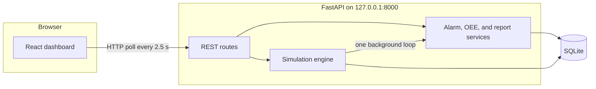

# Smart Machine Monitoring Dashboard

A local, software-only factory monitoring simulation for academic presentation and cooperative-education preparation. Engineers can watch four simulated machines, inspect sensor trends, respond to alarms, and review basic Overall Equipment Effectiveness (OEE).

The simulator does **not** connect to real PLCs, SCADA systems, sensors, or production equipment. No hardware, API key, or paid service is required.

## Project background and motivation

A Mechatronics Management Trainee is expected to understand how a factory watches equipment: which machine is running, which sensor is drifting, which alarm needs a response, and how downtime affects output. Those questions are normally answered by a PLC and a SCADA or MES system.

This project recreates that workflow on a Windows computer so the same questions can be practiced before the placement starts. The machines, sensors, alarms, and production counts are generated by a Python simulation. The dashboard is a real web application: every control calls the API, and every chart is drawn from data stored in SQLite.

## Project objectives

- Simulate four machines with independent operating ranges and live sensor values.
- Show operating status, alarms, production, downtime, and a basic OEE calculation.
- Keep alarm history, production samples, and settings after the backend restarts.
- Give a presenter one-click scenarios for high temperature, vibration, overload, idle, and fault.
- Make the difference between acknowledging an alarm and resetting a fault explicit.

## Project scope

Included:

- Four simulated machines: Conveyor System, Packaging Machine, Electric Motor, and Inspection Station.
- Status values `RUNNING`, `IDLE`, `STOPPED`, and `FAULT`.
- Temperature (°C), vibration (mm/s), and motor current (A).
- Configurable warning and critical thresholds, plus simulation speed.
- Alarm history with acknowledgment, filters, and CSV export.
- Production counts, time accounting, OEE, reports, and CSV export.
- A React dashboard that polls the API about every 2.5 seconds.

Not included:

- Physical sensors, ESP32 boards, PLCs, or industrial networks.
- A connection to a real SCADA, historian, or MES.
- Authenticated users, multi-site plants, or predictive-maintenance models.

The example ranges in the simulator (roughly 35–75 °C, 0.5–4.5 mm/s, and 2–12 A) are teaching values. They are not universal industrial safety limits.

## System architecture



The simulation engine is a single daemon thread. Start, pause, and resume change that loop; they do not create a second one. Each tick writes a metric sample and evaluates thresholds. The React app never invents chart values. It renders the JSON returned by the API.

Pausing freezes sensor values and production counters. Stopping or faulting an individual machine is separate from pausing the whole simulator.

## Technology stack

| Technology | Role | Why it was chosen |
| --- | --- | --- |
| React + TypeScript | Dashboard UI | Typed components and a clear page structure for a presentation. |
| Vite | Frontend dev server and build | Fast local startup and a simple proxy to the API. |
| Tailwind CSS | Layout and theme | Consistent dark industrial styling without a heavy component kit. |
| Recharts | Sensor, OEE, and report charts | Small API and works with the JSON arrays from FastAPI. |
| FastAPI | REST API | Automatic request validation and Swagger UI at `/docs`. |
| Pydantic | Settings and response models | Rejects invalid thresholds before they reach the simulator. |
| SQLite + SQLAlchemy | Local database | A file database that needs no server and survives a restart. |
| Pytest | Backend tests | Covers simulation, alarms, OEE, settings, and HTTP responses. |
| Vitest | Frontend tests | Checks duration, percentage, and status formatting. |

Real-time updates use REST polling every 2.5 seconds. WebSockets were not required for this simulation, and polling is easy to explain in a review.

## Features and expected benefits

- **Factory overview.** Four machine cards show status, temperature, vibration, current, production, downtime, and the last update. Status colors are green for running, blue for idle, gray for stopped, and red for fault. Warning and critical alarms use amber and red.
- **Machine detail.** Sensor history, status history, recent alarms, thresholds, and production statistics for the selected machine.
- **Simulation controls.** Start, pause, and resume the simulator. Trigger a high-temperature, vibration, overload, idle, or fault scenario, then clear the scenario.
- **Alarms.** New threshold crossings create one active alarm, not a new row on every poll. Acknowledgment stores who-saw-it time and leaves a fault in place. Reset is a separate action.
- **Production and OEE.** Running, idle, fault, and stopped time are tracked with good and defective counts.
- **Reports.** Uptime, downtime, alarm frequency, production, OEE, and sensor trends come from stored samples. Date filters limit that query. Alarm history and the production summary export as CSV.
- **Settings.** Warning thresholds, critical thresholds, and simulation speed are validated. A reset asks for confirmation before it clears a fault.

For a trainee, the useful habit is the same one used on a real line: look at the live status, open the trend, read the alarm text, record that it was seen, and only then recover the machine.

## Database design

SQLite file: `backend/data/monitoring.db`. It is created automatically.

| Table | Purpose |
| --- | --- |
| `machines` | Identity, status, live sensors, cumulative production and time, normal ranges, and thresholds. |
| `metric_samples` | Each simulator tick: status, sensor values, elapsed simulated seconds, and items produced. Reports are summed from this table. |
| `alarms` | Alarm id, machine, type, severity (`INFO`, `WARNING`, `CRITICAL`), description, timestamps, active flag, and acknowledgment. |
| `status_events` | Status changes such as start, stop, fault, and reset, with a short note. |
| `settings` | Simulation speed and whether the simulator was paused. |

The demo seed loads all four machines, a short mixed history (running, idle, stopped, and fault), and four already-acknowledged historical alarms so the reports are not empty on the first screen.

## OEE calculation

The production page labels these numbers as simulated.

```text
OEE = Availability × Performance × Quality

Availability = operating time / planned production time
Performance  = (ideal cycle time × total count) / operating time
Quality      = good count / total count
```

In this project:

- Operating time is running time.
- Planned production time is running + idle + fault + stopped time.
- Downtime is fault time + stopped time.
- Idle time is tracked on its own and reduces availability because it is inside the planned window.
- A zero denominator returns 0 instead of an error.
- Each factor is capped at 100% before the factors are multiplied. If the simulated rate is faster than the ideal cycle, the raw performance is still available from the API as `performance_raw`.

A real factory OEE needs verified production counts and verified machine-time data. This screen is a calculation exercise on simulator output.

## API documentation

With the backend running, open:

- Swagger UI: [http://127.0.0.1:8000/docs](http://127.0.0.1:8000/docs)
- Health check: [http://127.0.0.1:8000/api/health](http://127.0.0.1:8000/api/health)

Main routes:

| Method | Path | Purpose |
| --- | --- | --- |
| GET | `/api/health` | API and simulator state |
| GET | `/api/machines` | All machines and live readings |
| GET | `/api/machines/{machine_id}` | One machine |
| GET | `/api/machines/{machine_id}/history` | Readings, status history, recent alarms |
| POST | `/api/machines/{machine_id}/start` | Start a machine that is not in fault |
| POST | `/api/machines/{machine_id}/stop` | Controlled stop |
| POST | `/api/machines/{machine_id}/reset` | Clear fault and scenario, return to IDLE |
| GET | `/api/alarms` | Filter by machine, severity, and acknowledgment |
| GET | `/api/alarms/export` | Alarm history CSV |
| POST | `/api/alarms/{alarm_id}/acknowledge` | Record acknowledgment |
| GET | `/api/production/summary` | Counts, time, and OEE |
| GET | `/api/production/export` | Production summary CSV |
| GET | `/api/reports/summary` | Optional `from` and `to` ISO timestamps |
| GET / PUT | `/api/settings` | Read or update speed and thresholds |
| POST | `/api/simulation/start` | Start the background loop |
| POST | `/api/simulation/pause` | Freeze updates |
| POST | `/api/simulation/resume` | Continue updates |
| POST | `/api/simulation/scenarios/{scenario_name}` | Body: `{ "machine_id": "MCH-A" }` |

Scenario names: `high_temperature`, `excessive_vibration`, `motor_overload`, `machine_fault`, `idle`, and `clear`.

Starting a machine that is in `FAULT` returns HTTP 409. The response tells the operator to reset first.

## Installation and startup on Windows PowerShell

Use two terminals. Python 3.11 or newer and Node.js 20 or newer are required. These steps were checked with Python 3.14 and Node.js 24.

### Backend

```powershell
cd "E:\project final\backend"
python -m venv .venv
.\.venv\Scripts\python.exe -m pip install -r requirements.txt
.\.venv\Scripts\python.exe -m uvicorn app.main:app --host 127.0.0.1 --port 8000
```

The API listens on [http://127.0.0.1:8000](http://127.0.0.1:8000). The database file is created on first startup, and the simulator starts on its own.

### Frontend

```powershell
cd "E:\project final\frontend"
npm install
npm run dev
```

The dashboard listens on [http://127.0.0.1:5173](http://127.0.0.1:5173). Vite proxies `/api` to the backend, so the browser does not need a separate CORS setup during development. CORS is still enabled for `localhost:5173` and `127.0.0.1:5173`.

Leave both terminals open during the demonstration.

## Testing

Backend, from `backend`:

```powershell
.\.venv\Scripts\python.exe -m pytest
```

The suite covers:

- simulation ticks, idle production, temperature scenarios, and a single background thread
- threshold detection, escalation, clearing, and acknowledgment
- machine start, stop, reset, and the rule that acknowledgment does not clear a fault
- OEE arithmetic, caps, and zero denominators
- health, machines, history, reports, CSV export, and error status codes
- settings validation for speed, threshold order, and the normal operating band

Frontend, from `frontend`:

```powershell
npm test
npm run build
```

`npm test` checks formatting helpers. `npm run build` typechecks the TypeScript and produces the production bundle.

## Five-minute demo

1. Open [http://127.0.0.1:5173](http://127.0.0.1:5173). Explain the four simulated machines and point out that the header says the simulation is running. Values change without a page refresh.
2. Open **Conveyor System**. Show the temperature, vibration, and current charts, and the configured thresholds.
3. Click **High temperature**. Within a few seconds the temperature crosses the warning line, an alarm toast appears, and the Alarms page shows one new active alarm. Triggering it again does not create a duplicate while that alarm is still active.
4. Click **Machine fault**. The status turns red and production stops. Open the alarm and click **Acknowledge**. The status stays `FAULT`. Say explicitly that acknowledgment only records that the alarm was seen.
5. Click **Reset**, confirm the dialog, and show the machine return to `IDLE`. The fault alarm is cleared but its acknowledgment history is unchanged. Click **Start** to run it again.
6. Open **Production & OEE**. Walk through running time, idle time, fault downtime, and the formula. State that these are simulated metrics.
7. Open **Reports** if time remains, and export a CSV.
8. Close with the operating benefit: the same screens help an engineer see which asset is down, what the sensor did before the alarm, and whether the response was acknowledgment or recovery.

The same scenario buttons are on the machine detail page and on **Settings**.

## Current limitations

- The process is a simulation. Sensor noise, cycle time, and defect rate are configured teaching parameters.
- OEE uses the time categories above. A plant may define planned time, changeover, and quality differently.
- History retention keeps the latest 1,200 samples per machine so the SQLite file stays small.
- There is no user login. Anyone who can open the local app can acknowledge alarms and change thresholds.
- Polling is every 2.5 seconds, so the screen is not a hard real-time control loop.
- The FastAPI test client currently prints a Starlette deprecation warning about `httpx`. The tests still run.

## Future improvements

These are possible next steps. They are not implemented, and this version does not require them.

- Read and write holding registers through Modbus TCP once a PLC or a PLC simulator is available.
- Mirror the same tags in an industrial SCADA platform and keep this dashboard as a training view.
- Replace simulated sensors with measured temperature, vibration, and current, after the scaling and alarm setpoints are reviewed with the plant.
- Add operator login, audit trails, and shift calendars so OEE uses the site's real planned-production calendar.
- Connect downtime reasons and scrap codes to the maintenance and quality systems used on the placement.

## Relation to a Mechatronics Management Trainee role

The placement asks a trainee to follow equipment condition, production results, and abnormal events, then explain them clearly to engineers and technicians. This project practices that loop:

- Read machine state and the three common electrical/mechanical signals: temperature, vibration, and current.
- Separate a warning from a fault, and separate "I have seen the alarm" from "the machine is recovered."
- Use uptime, downtime, and a basic OEE figure to describe a shift in numbers, while being honest about where the numbers came from.
- Trace a problem from the overview, to the trend, to the alarm history.
- Keep the explanation at a level a maintenance technician and a supervisor can both use.

That is the monitoring habit the dashboard is meant to build before the trainee meets the real line.
